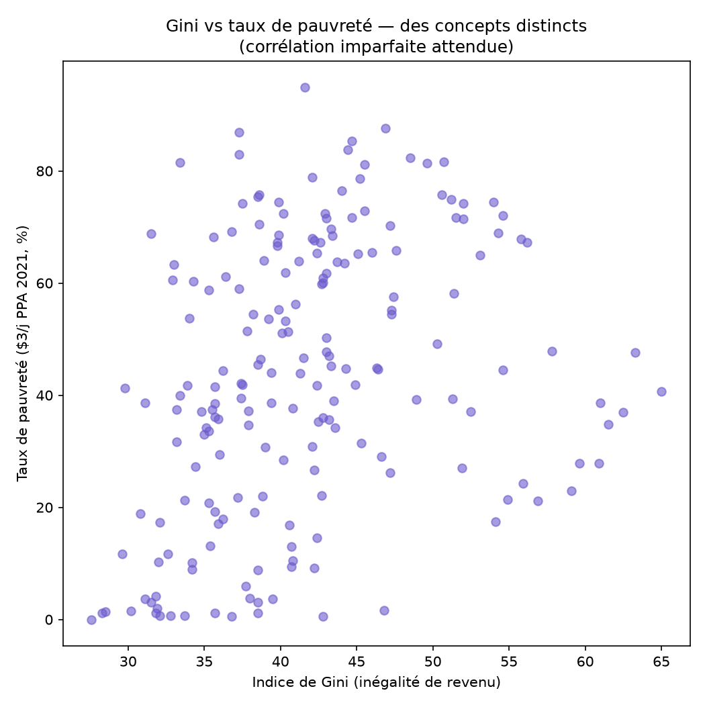
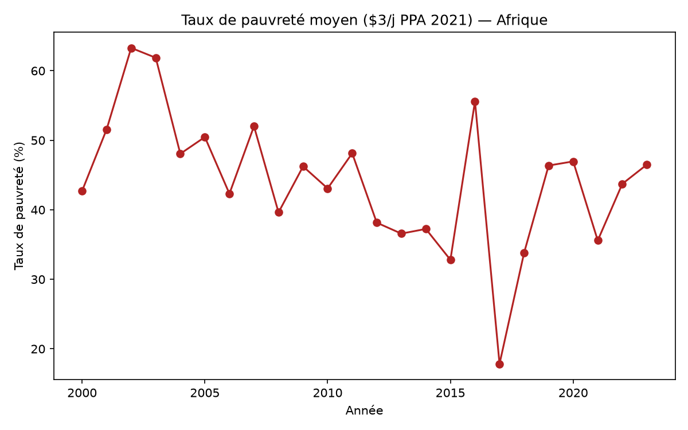
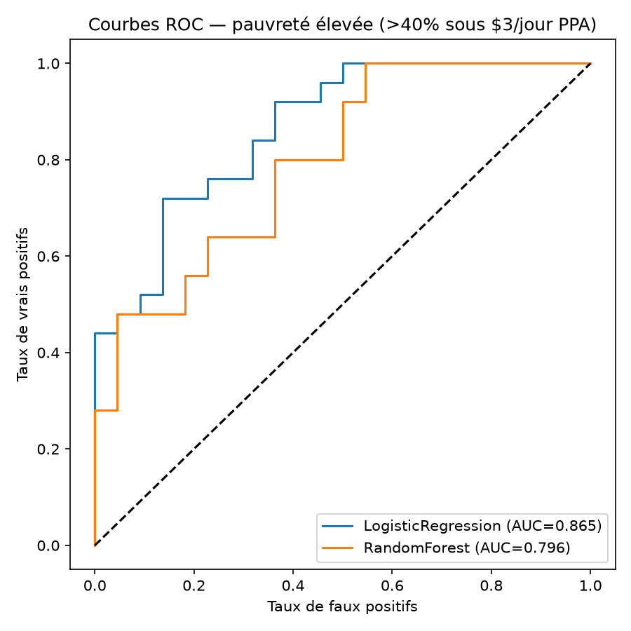
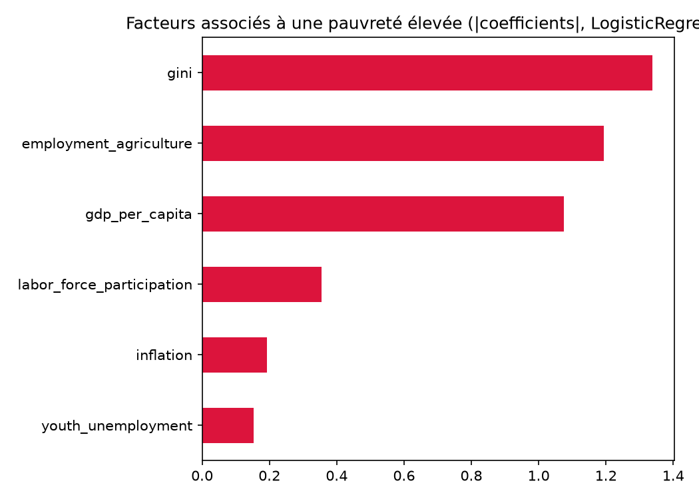
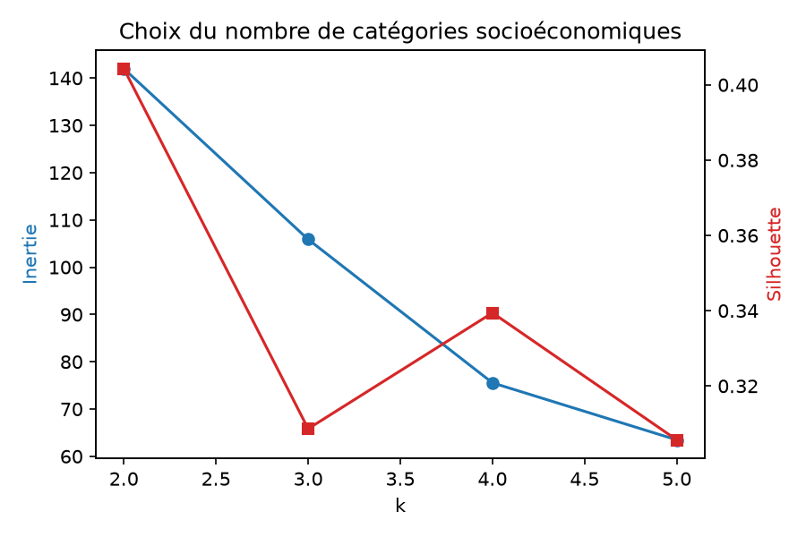
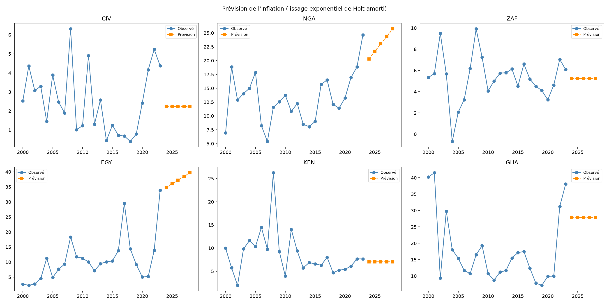
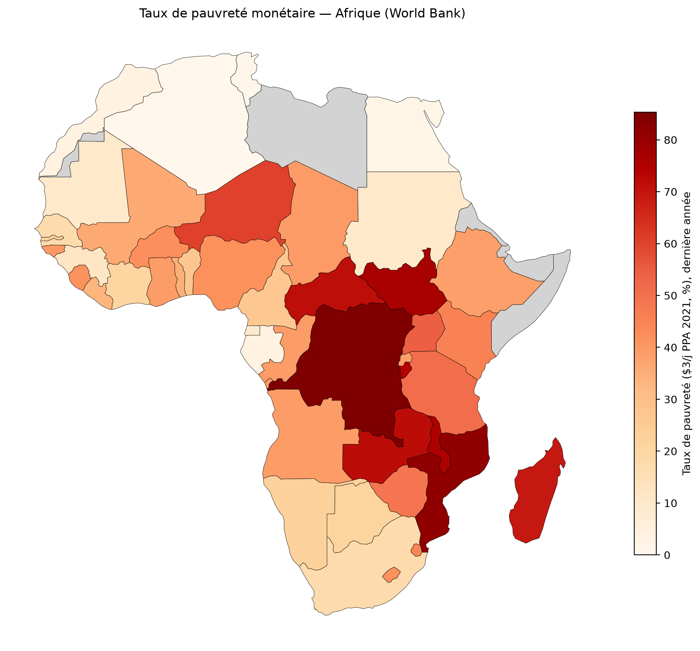

# Pauvreté et développement en Afrique : ce que révèlent 23 ans de données économiques

*Média Marcel Bakayoko — Expert géomatique / données géospatiales & agricoles / GeoAI / Suivi-Évaluation*

## Le problème

La pauvreté monétaire en Afrique reste très hétérogène — de pays quasiment sortis de la pauvreté
extrême à d'autres où plus de 80% de la population vit sous le seuil de $3/jour (parité de pouvoir
d'achat 2021). Ce projet mobilise les données ouvertes de la Banque Mondiale pour identifier les
facteurs structurels associés à la pauvreté, construire des catégories socioéconomiques de pays,
et prévoir les tendances d'inflation.

## Les données

53 pays africains, 2000-2023, 1 272 observations pays-année : taux de pauvreté (seuil national et
$3/jour PPA), indice de Gini, PIB par habitant, inflation, chômage des jeunes, taux d'activité et
part de l'emploi agricole.

## Un rappel méthodologique nécessaire : Gini ≠ pauvreté

L'indice de Gini mesure l'inégalité relative de la distribution des revenus ; le taux de pauvreté
mesure la part de la population sous un seuil absolu. Ce projet calcule explicitement leur
corrélation empirique sur l'échantillon africain : **r = 0,31** — une corrélation faible à
modérée, qui confirme qu'un pays très inégalitaire n'est pas nécessairement un pays très pauvre
(et inversement). Confondre les deux conduirait à des erreurs de diagnostic et de ciblage des
politiques publiques.

## Tendance continentale

Le taux de pauvreté moyen africain montre une évolution contrastée sur la période, avec des écarts
importants selon les pays disponibles dans l'échantillon à chaque période — la trajectoire
continentale masque des dynamiques nationales très différentes, comme le confirme la carte ci-dessous.

## Peut-on prédire les pays à risque de pauvreté élevée ?

Deux modèles ont été comparés pour prédire le statut "pauvreté élevée" (plus de 40% de la
population sous $3/jour) : régression logistique (AUC = 0,87 test, 0,88 en validation croisée) et
Random Forest (AUC = 0,80 test, 0,89 en validation croisée). Les deux modèles convergent vers une
performance robuste (~0,88 en CV), la régression logistique s'avérant légèrement plus stable sur
cet échantillon de taille modérée (186 observations).

Les facteurs les plus discriminants du risque de pauvreté élevée incluent le PIB par habitant,
l'indice de Gini et la part de l'emploi agricole — une économie dominée par l'agriculture de
subsistance et un PIB par habitant faible restent les signaux les plus forts de pauvreté
structurelle, cohérent avec la littérature en économie du développement.

## Deux Afriques économiques

Le clustering K-Means sur le PIB par habitant, le taux de pauvreté, le Gini, le chômage des
jeunes et la part de l'emploi agricole fait émerger **deux groupes nets** de pays :
- **Groupe 1 (15 pays)** : PIB par habitant moyen ≈ 5 100 $, pauvreté moyenne 13%, emploi
  agricole 21% — économies plus diversifiées.
- **Groupe 2 (34 pays)** : PIB par habitant moyen ≈ 1 235 $, pauvreté moyenne 45%, emploi
  agricole 53% — économies à dominante agricole, vulnérabilité structurelle plus marquée.

Cette bipartition nette (2 clusters optimaux au sens du score de silhouette) illustre une fracture
économique persistante sur le continent, davantage liée à la structure productive (poids de
l'agriculture de subsistance) qu'à la seule géographie.

## Prévisions d'inflation

Des prévisions à 5 ans (lissage exponentiel de Holt amorti) ont été produites pour six économies
représentatives :
- **Nigeria** : 24,7% (2023) → 25,7% (2028 prévu) — inflation structurellement élevée et persistante.
- **Égypte** : 33,9% (2023) → 39,7% (2028 prévu) — trajectoire préoccupante.
- **Ghana** : 38,1% (2023) → 27,8% (2028 prévu) — désinflation progressive anticipée.
- **Côte d'Ivoire** : 4,4% (2023) → 2,2% (2028 prévu) — zone de stabilité monétaire (UEMOA).
- **Kenya** : 7,7% (2023) → 7,0% (2028 prévu) — stabilité relative.
- **Afrique du Sud** : 6,1% (2023) → 5,2% (2028 prévu) — proche de la cible de la banque centrale.

Ces prévisions, à prendre comme projections tendancielles et non comme certitudes, illustrent des
trajectoires très différenciées selon les régimes monétaires (zone UEMOA à change fixe vs régimes
de change flottant plus exposés aux chocs).

## Cartographie de la pauvreté

La carte confirme une forte concentration de la pauvreté en Afrique centrale et australe-Est :
RD Congo (85%), Mozambique (81%), Soudan du Sud (77%), Malawi (75%), Burundi (74%), Zambie (72%),
Centrafrique (72%), Madagascar (69%). À l'opposé, l'Algérie (0%), Tunisie, Maurice, Seychelles et
Égypte affichent des taux quasi nuls sur cet indicateur.

## Recommandations

1. **Cibler les investissements productifs sur le groupe de pays à dominante agricole** (cluster 2)
   pour diversifier l'économie et réduire la dépendance à l'agriculture de subsistance — levier
   structurel le plus fortement associé à la réduction de la pauvreté dans cette analyse.
2. **Ne pas utiliser le Gini comme proxy de pauvreté** dans le ciblage des politiques sociales : la
   faible corrélation observée (0,31) implique que des interventions anti-inégalités et anti-pauvreté
   répondent à des logiques différentes et doivent être pensées séparément.
3. **Suivre de près les économies à forte inflation projetée** (Nigeria, Égypte) où le pouvoir
   d'achat des ménages pauvres est le plus exposé à l'érosion monétaire.
4. **S'inspirer des stratégies de stabilité monétaire de la zone UEMOA** (Côte d'Ivoire) pour les
   pays cherchant à limiter la volatilité inflationniste.

## Limites

- Le taux de pauvreté au seuil $3/jour PPA n'est pas disponible chaque année pour tous les pays —
  les comparaisons inter-pays portent sur des années parfois éloignées (voir `reports/country_summary.csv`).
- Les prévisions d'inflation reposent sur un modèle de lissage exponentiel simple (tendance
  amortie), qui ne capture pas les chocs exogènes (crises de change, chocs pétroliers, conflits).
- Le clustering à 2 groupes, bien que statistiquement optimal (score de silhouette), simplifie une
  réalité plus continue — des catégories intermédiaires existent mais sont absorbées dans les
  deux groupes dominants.

---
*Source : World Bank Open Data, https://data.worldbank.org — CC BY 4.0.*
